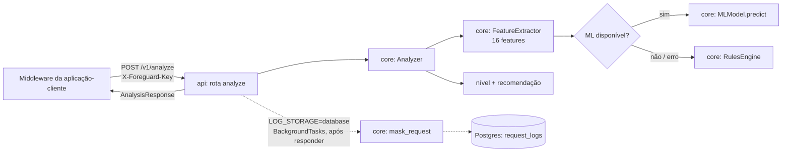

# Arquitetura — visão geral

## Objetivo

Mapear as camadas do Foreguard, o fluxo de uma análise e onde cada
responsabilidade mora no pacote `foreguard/`. Contratos completos em
[`../specs/arquitetura.md`](../specs/arquitetura.md),
[`../specs/integracao.md`](../specs/integracao.md) e
[`../specs/instalacao.md`](../specs/instalacao.md).

## Audiência

- **Devs** — entender onde cada responsabilidade mora antes de alterar código.
- **Assistentes/agentes IA** — localizar módulos e dependências entre camadas.

---

## Fluxo de uma análise



A aplicação-cliente decide o que fazer com o resultado; o middleware é
fail-open ([`../guides/middleware.md`](../guides/middleware.md)).

Dependências permitidas: `api → core`, `api → db`, `core → config`.
`core` não importa `api` nem `db` (verificado em `tests/test_project.py`).

## Layout

```
foreguard/
├── __init__.py          # __version__
├── __main__.py          # python -m foreguard → CLI
├── cli.py               # foreguard install | serve
├── config.py            # Settings + get_settings() (lru_cache)
├── api/
│   ├── main.py          # create_app(), app, lifespan, /health
│   ├── security.py      # X-Foreguard-Key, limite MAX_REQUEST_BYTES
│   ├── schemas.py       # IncomingRequest, AnalysisResponse, LogSummary, LogDetail
│   └── routes/          # analyze.py (POST /v1/analyze), logs.py (GET /v1/logs[/{id}])
├── core/                # analyzer, extractor, rules, ml_model, masking
└── db/                  # base, models (RequestLog), session, migrations/ (Alembic)
scripts/install.py       # bootstrap só-stdlib: venv + pip install + foreguard install
models/                  # .pkl do modelo treinado (ignorado pelo git)
tests/                   # pytest; conftest com SQLite em memória
```

## Decisões de implementação

- **Sem efeito colateral no import:** settings, engine e sessão são criados
  sob demanda (`get_settings()`, `get_engine()`, `get_session_factory()`),
  com cache por `DATABASE_URL`.
- **Rotas por modo:** `create_app()` lê `LOG_STORAGE` e registra
  `analyze_request` (client) ou `analyze_and_store` (database); `/v1/logs` só
  existe no modo database. Todas as rotas `/v1` exigem `X-Foreguard-Key`.
- **Startup (`lifespan`)**: valida `FOREGUARD_API_KEY` (≥ 32 chars) e, no
  modo database, `DATABASE_URL`; configura o loguru (stdout + arquivo JSON
  diário em `LOG_DIR`). Não cria tabelas.
- **Gravação fora do caminho crítico:** a análise responde e a gravação roda
  em `BackgroundTasks`, com mascaramento; qualquer erro vira log, nunca falha
  da análise.
- **Rotas síncronas (`def`):** análise CPU-bound e banco bloqueante rodam no
  threadpool do FastAPI.
- **ML injetável:** `Analyzer(ml_model=...)`; o default é o singleton
  `foreguard.core.ml_model.ml_model`, que lê `ML_MODEL_PATH`.
- **Migrações empacotadas** em `foreguard/db/migrations/`: o instalador as
  aplica a partir do pacote instalado; o `env.py` delas aceita a URL
  injetada (`config.attributes["database_url"]`) ou a das settings.

---

## Referências

- Entrypoint e startup: [`foreguard/api/main.py`](../../../foreguard/api/main.py)
- Auth e limite: [`foreguard/api/security.py`](../../../foreguard/api/security.py)
- Rotas: [`foreguard/api/routes/analyze.py`](../../../foreguard/api/routes/analyze.py),
  [`foreguard/api/routes/logs.py`](../../../foreguard/api/routes/logs.py)
- Config: [`foreguard/config.py`](../../../foreguard/config.py)
- CLI: [`foreguard/cli.py`](../../../foreguard/cli.py)
- Orquestração: [`foreguard/core/analyzer.py`](../../../foreguard/core/analyzer.py)
- Extração: [`foreguard/core/extractor.py`](../../../foreguard/core/extractor.py)
- Mascaramento: [`foreguard/core/masking.py`](../../../foreguard/core/masking.py)
- Banco: [`foreguard/db/models.py`](../../../foreguard/db/models.py),
  [`foreguard/db/session.py`](../../../foreguard/db/session.py)
- Migrações: [`foreguard/db/migrations/env.py`](../../../foreguard/db/migrations/env.py)
